# 📖 Читалка — библиотека и чтение книг

Настольное приложение для Windows: аккуратная **домашняя библиотека**, **читалка**
с постраничной вёрсткой, **каталоги общественного достояния**, **статистика
чтения**, а также **словарь, перевод, заметки и выделения**. Поддерживает
**FB2**, **FB2.ZIP**, **EPUB**, **PDF** и **TXT**, работает офлайн; каталоги,
словарь и перевод подключаются по сети.

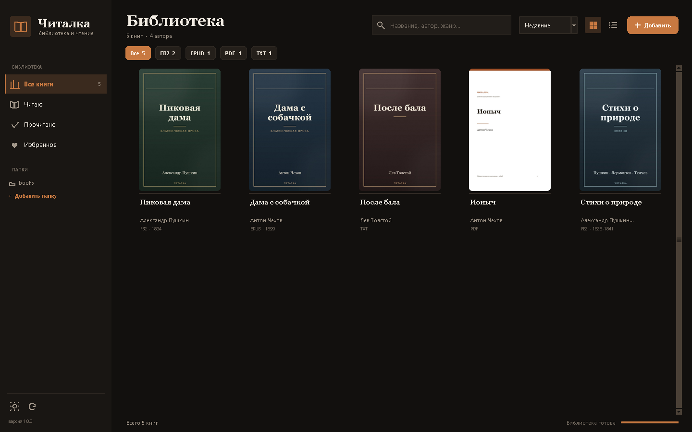

## Быстрый старт

1. **Добавьте книги** — кнопка «Добавить книги» → «Папка» или «Файлы».
   Подойдут FB2, EPUB, PDF и TXT. Файлы и папки можно **просто перетащить**
   в окно библиотеки. Или скачайте книгу из Gutenberg.
2. **Откройте книгу** — двойной клик по обложке. Кнопка «Продолжить» на главной
   возвращает к последней книге.
3. **Читайте** — выделите текст мышью: появятся словарь, перевод, маркер и заметка.

При первом запуске открывается короткий мастер из **трёх экранов**; на последнем
можно сразу включить режим **«Только чтение»** — без каталогов и статистики.

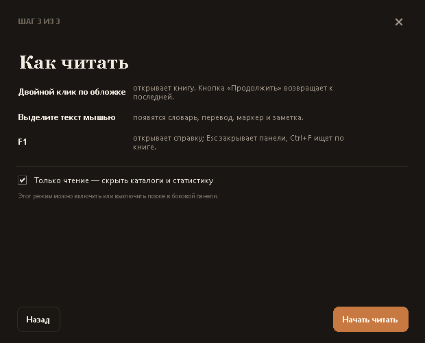

Если что-то непонятно, нажмите **?** в правом верхнем углу или **F1** — откроется
короткая справка со всеми основными действиями и горячими клавишами.

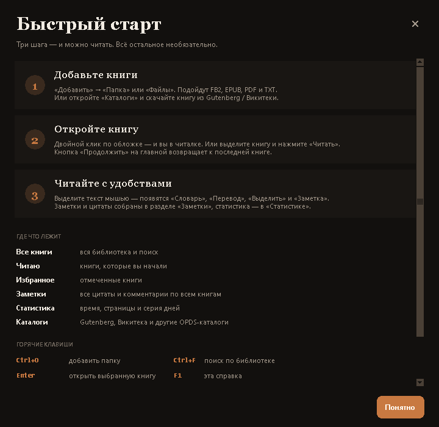

Если библиотека пуста, приложение само предлагает три действия — добавить папку,
добавить файлы или скачать книгу:

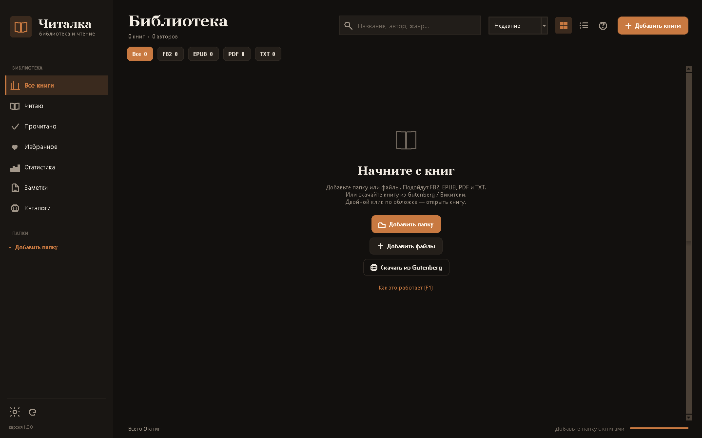

Режим «Только чтение» оставляет книги, читалку и заметки:

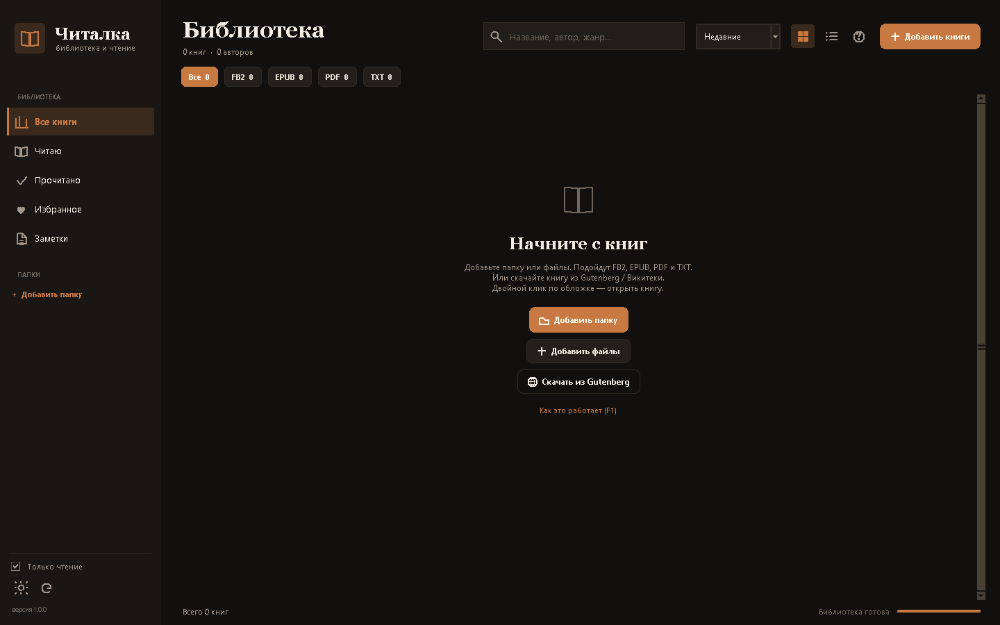

## Возможности

### Библиотека

- Сканирование папок **рекурсивно**: добавляйте целые коллекции книг.
- Карточки с обложками, автором, годом, форматом и прогрессом чтения.
- **«Продолжить»** на главной — возврат к последней книге в один клик.
- **Перетаскивание файлов и папок** прямо в окно библиотеки.
- **Режим «Только чтение»** — скрывает каталоги и статистику, оставляя книги,
  читалку и заметки.
- **F1 / кнопка «?»** — короткая справка со всеми основными действиями.
- Поиск по названию, автору, серии и жанру — мгновенный, по локальной базе SQLite.
- Фильтры по формату, коллекции **«Читаю»**, **«Прочитано»**, **«Избранное»**.
- Сортировка: недавние, по названию, автору, году, прогрессу, дате добавления.
- Два вида: **обложками** и **списком**.
- Карточка книги: аннотация, метаданные, размер файла, прогресс, кнопка
  «Читать / Продолжить / Перечитать».
- Если у книги нет обложки, рисуется типографская обложка в книжном стиле.
- Тёмная и светлая темы интерфейса (кнопка ☀/☾ внизу слева).
- Импорт в фоне: интерфейс не подвисает, виден прогресс.
- **Каталоги Project Gutenberg, Викитеки и любые OPDS 1/2** — поиск и скачивание
  книг прямо в библиотеку.
- **Статистика чтения**: активное время, страницы, серия дней, цель на месяц.
- **Офлайн-словарь** FreeDict (104 781 статья), **перевод по выделению**,
  **цветные маркеры**, комментарии, список заметок и экспорт в Markdown.

### Читалка

- **Постраничная вёрстка** с переносами, выравниванием по ширине и абзацными
  отступами.
- Оглавление FB2/EPUB/PDF, переход по главам.
- Закладки с заметками, сохранение прогресса и позиции между запусками.
- Поиск по всей книге с фрагментами и переходом на нужную страницу.
- Сноски FB2: всплывающее окно с примечанием.
- Иллюстрации внутри FB2/EPUB.
- Четыре темы страницы: **Бумага**, **Сепия**, **Графит**, **Ночь**.
- Настройки: шрифт, размер, межстрочный интервал, поля, выравнивание,
  колонтитулы, новая страница с главы.
- Полноэкранный режим (F11), мышь, клавиатура, ползунок страниц.
- PDF показывается постранично «как в оригинале», с оглавлением и поиском.
- Копирование текста текущей страницы (Ctrl+C) или выделенного фрагмента.

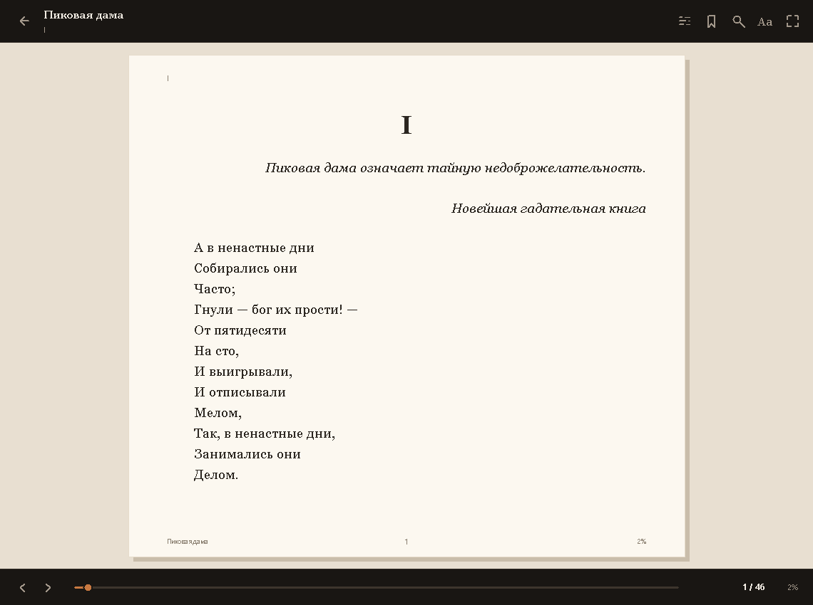

### Каталоги и общественное достояние

- **Project Gutenberg** — OPDS-каталог с десятками тысяч книг: поиск, обложки,
  скачивание EPUB прямо в библиотеку.
- **Викитека** — поиск русских текстов и сохранение страницы в FB2 с автором,
  главами и аннотацией.
- **Любые OPDS 1/2-каталоги** — добавьте название и ссылку, приложение запомнит
  каталог. Поиск работает, если каталог его поддерживает.
- Скачанные книги попадают в `data/books/Каталоги` и сразу появляются в библиотеке.

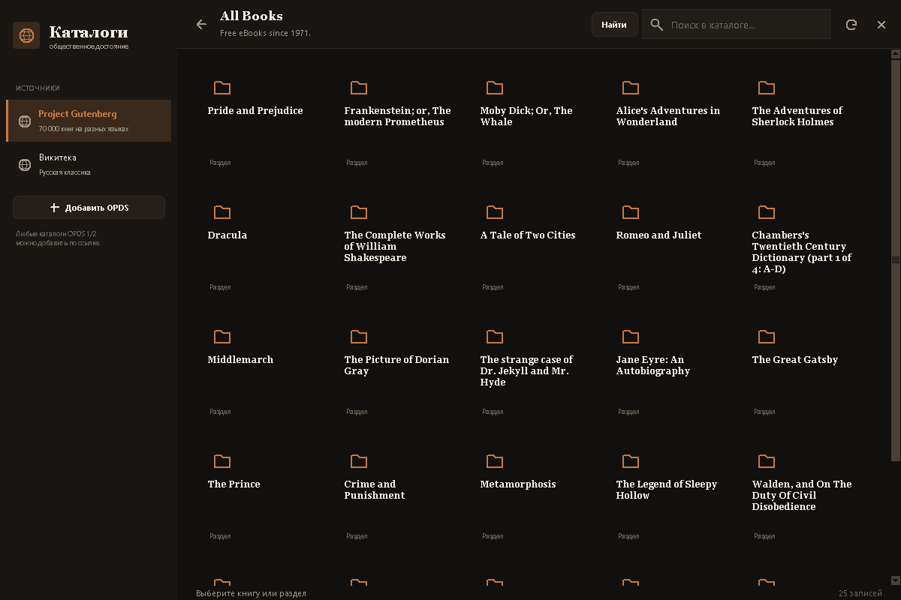

### Статистика чтения

- Активное время в читалке: приложение считает только те минуты, когда окно
  чтения действительно на экране, а вы перелистываете страницы или двигаете мышью.
- Страницы, дни чтения и **серия дней подряд**.
- График за последние 30 дней.
- **Цель на месяц** в минутах: прогресс и оставшееся время.
- Топ книг по времени.

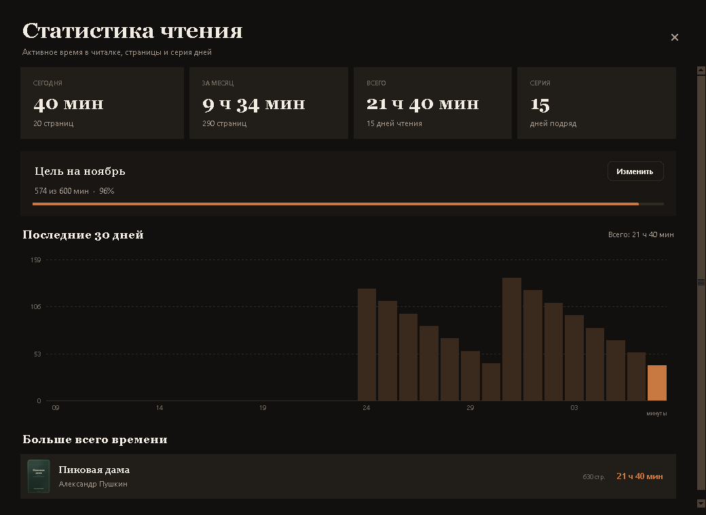

### Словарь и перевод по выделению

- Выделите слово или фразу мышью — появится панель действий.
- **Офлайн-словарь**: FreeDict/WikDict, 42 600 русско-английских и 62 181
  англо-русских статей. Работает без интернета.
- **Онлайн-словарь** (Викисловарь) используется, если слова нет
  в офлайн-словаре.
- **Перевод**: одиночные слова — сразу по офлайн-словарю; фразы — через
  **DeepL API** или собственный **LibreTranslate** после настройки.
  MyMemory доступен как ограниченный вариант, но не подходит для больших объёмов.
  Удачные ответы сохраняются в локальный кэш и потом доступны без сети.
- **Настроить перевод** — ссылка внизу окна словаря. Ключи и адрес хранятся
  только локально.
- Язык определяется автоматически: русский → английский и наоборот; направление
  можно поменять в окне.
- Перевод и словарную статью можно скопировать или открыть в браузере.

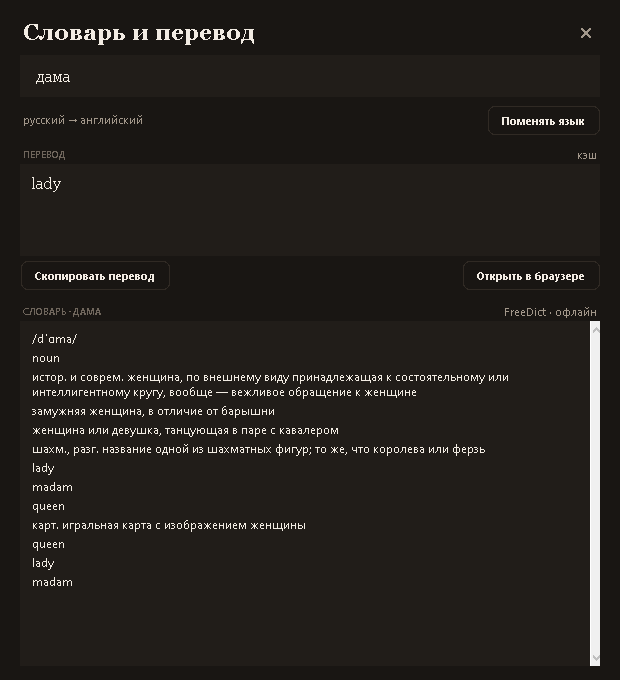

Настройка коммерчески допустимого перевода — DeepL или собственный
LibreTranslate:

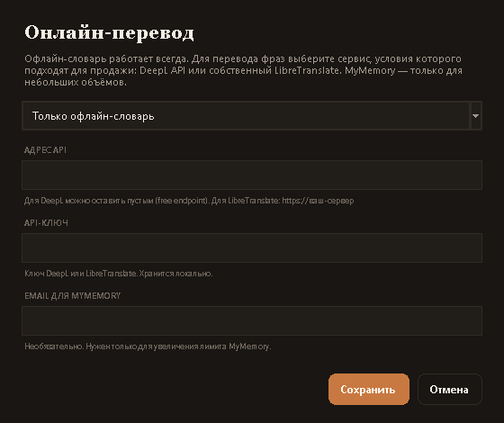

Офлайн-словарь лежит в `data/dictionaries/freedict.sqlite.xz` и распаковывается
при первом обращении. Источник — [FreeDict](https://freedict.org/) /
[WikDict](https://www.wikdict.com/), данные распространяются по лицензии
[CC BY-SA 3.0](https://creativecommons.org/licenses/by-sa/3.0/); текст лицензии
лежит рядом в `data/dictionaries/LICENSE-CC-BY-SA.txt`. Собрать словарь заново
можно командой `python tools/build_offline_dict.py`.

### Заметки и выделения

- **Четыре цвета маркеров**: жёлтый, зелёный, голубой, розовый.
- Выделение сохраняется в книге; к нему можно добавить комментарий.
- Работает в **FB2/EPUB/TXT и PDF**: в PDF выделяются слова с текстовым слоем,
  маркер рисуется поверх страницы.
- **«Заметки и выделения»** — список всех заметок книги: цитата, комментарий,
  глава и страница. По заметке можно перейти к тексту, изменить цвет/комментарий
  или удалить её.
- **«Все заметки»** в библиотеке — общий список по всем книгам с поиском,
  удалением и экспортом.
- **Экспорт в Markdown** — заметки книги или всей библиотеки с цитатами,
  комментариями и страницами сохраняются в `.md`.
- Заметки в текстовых книгах привязаны к блокам и смещениям, поэтому остаются на
  месте при изменении шрифта, кегля и ширины страницы.

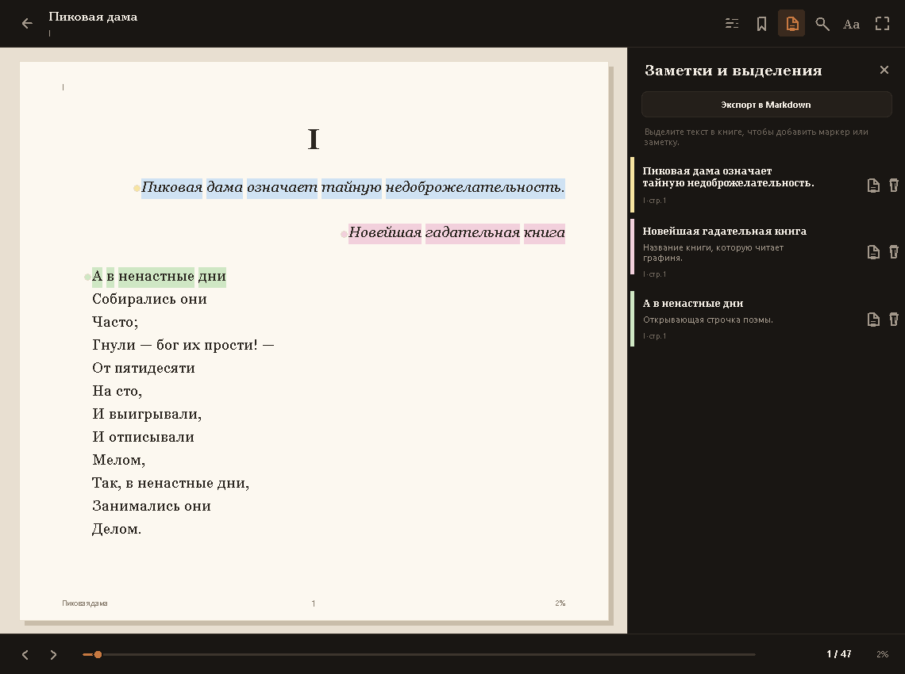

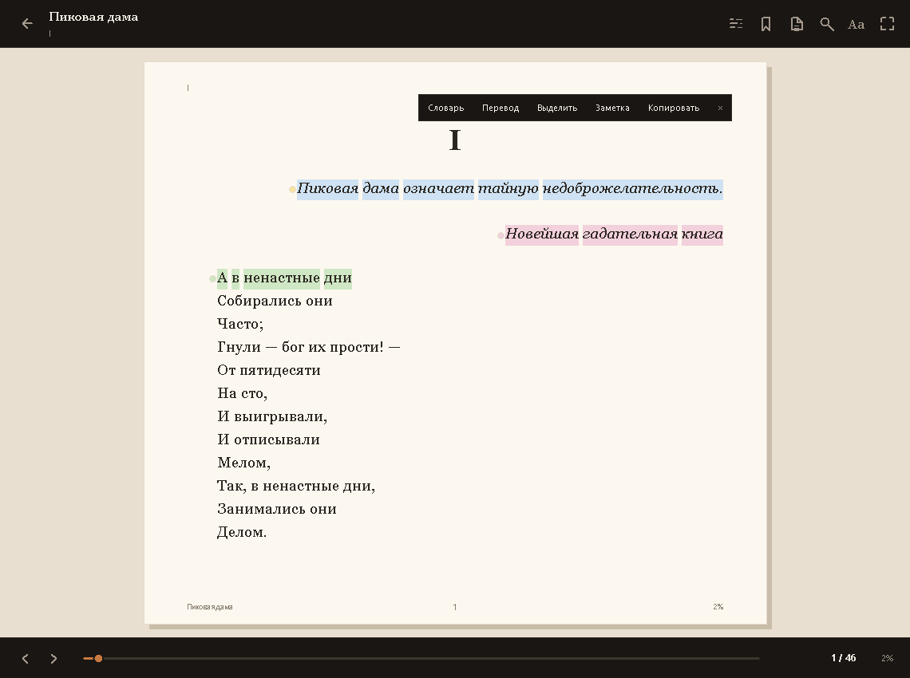

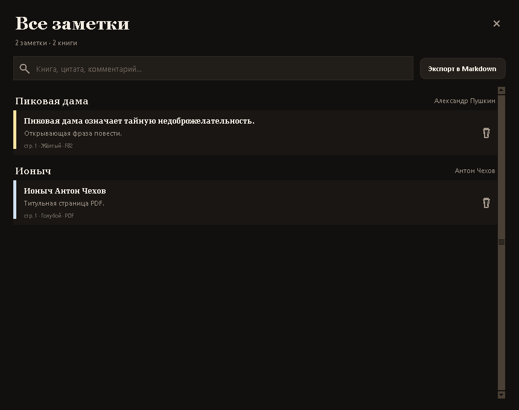

PDF-выделение:

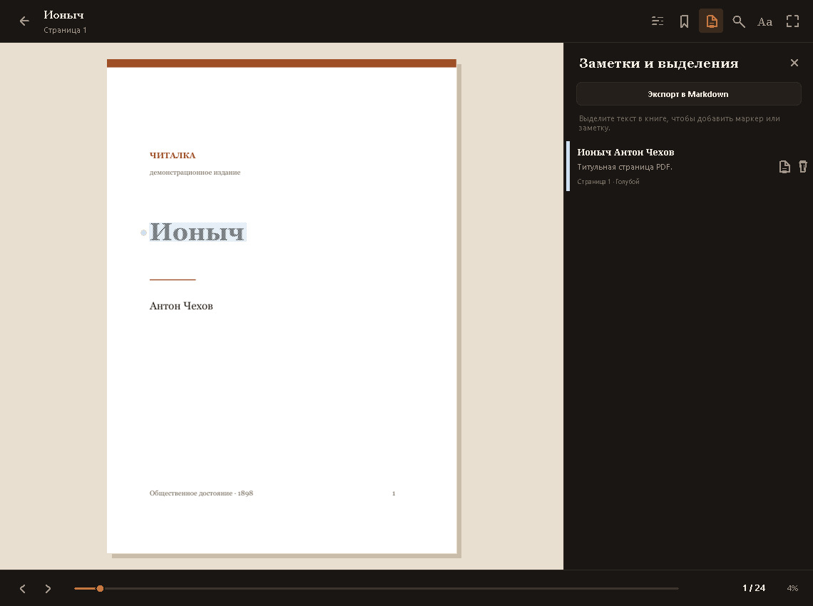

## Форматы

| Формат | Чтение | Метаданные | Обложка |
| --- | --- | --- | --- |
| FB2 | ✅ постранично | название, авторы, жанр, год, серия, аннотация | из книги |
| FB2.ZIP | ✅ постранично | то же | из книги |
| EPUB 2/3 | ✅ постранично | название, автор, язык, аннотация | из книги |
| PDF | ✅ страницы | название, автор | первая страница |
| TXT | ✅ постранично | название/автор из имени файла, кодировка UTF-8/CP1251/KOI8-R | генерируется |

Дополнительно: `.zip`, внутри которого лежит один `.fb2`, распознаётся как FB2.

> **Пока не поддерживаются внутри:** MOBI, AZW3, DJVU, DOCX и книги с DRM.
> Для них нужна внешняя программа или конвертация в EPUB/FB2.

## Быстрый запуск

### Вариант 1 — готовый exe (Python не нужен)

Откройте `dist/Chitalka/Chitalka.exe`. Папку `dist/Chitalka` целиком можно
скопировать на рабочий стол или флешку — книги и база лежат внутри `data`.

### Вариант 2 — один клик из исходников

```bat
run.bat
```

Скрипт найдёт Python, при первом запуске доставит `Pillow`, `pypdfium2`, `lxml`,
запустит программу без лишней консоли и покажет понятное сообщение, если Python
не установлен.

### Вариант 3 — вручную

```bat
pip install -r requirements.txt
python main.py
```

Нужен Python 3.10+ (проверено на 3.11) и Windows 10/11. `tkinter` входит в
стандартную сборку Python для Windows.

### Проверка установки

```bat
python main.py --selftest
```

Самопроверка читает все демо-книги, проверяет вёрстку, базу, открывает
библиотеку и читалку, ищет по книге и пишет отчёт в `data/selftest.log`
с итогом `ИТОГ: OK` или списком проблем.

Дополнительно:

```bat
python main.py --repair                 :: проверить целостность базы
python main.py --shot data/shot.png     :: снимок библиотеки
python main.py --shot data/r.png --book "Пиковая дама" --page 5
```

## Данные и резервная копия

- В portable-режиме данные лежат в `data/` рядом с программой.
- Если папка программы недоступна для записи (например, `Program Files`),
  база, настройки и обложки автоматически переносятся в `%APPDATA%\Chitalka`.
- **«Добавить книги» → «Резервная копия…»** сохраняет `library.db`, настройки
  и обложки в один zip-архив.
- **«Восстановить из копии…»** заменяет библиотеку; текущая база сохраняется
  рядом как `library.db.before-restore-*`.

Книги в резервную копию не входят — они остаются в своих папках. Копию можно
сделать вручную в любой момент, даже во время работы приложения.

## Как добавить книги

1. Нажмите **«Добавить»** справа сверху.
2. Выберите **«Добавить папку…»** — приложение просканирует её и все подпапки.
3. Или **«Добавить файлы…»** — можно выбрать отдельные книги.
4. Список папок хранится в настройках; при следующем запуске они проверяются
   автоматически (новые файлы добавляются, изменённые — обновляются).

Файлы **не копируются** и **не изменяются**. В базе хранится путь, метаданные и
прогресс; обложки кэшируются в `data/covers`, иллюстрации — в `data/images`.
Удаление из библиотеки убирает только запись, файл на диске остаётся.

## Горячие клавиши

| Клавиша | Действие |
| --- | --- |
| `←` / `→`, `PgUp` / `PgDn` | предыдущая / следующая страница |
| `Space` / `Shift+Space` | вперёд / назад |
| `Home` / `End` | начало / конец книги |
| `Ctrl+O` | добавить папку с книгами |
| `Ctrl+F` | поиск по библиотеке / книге |
| `Enter` | открыть выбранную книгу |
| `F1` | быстрый старт и справка |
| `Ctrl+T` | оглавление |
| `Ctrl+B` | закладки |
| `Ctrl+C` | скопировать выделение или текст страницы |
| `Alt+←`, `Backspace` | назад по ссылкам/истории |
| `F11` | полноэкранный режим |
| `Esc` | снять выделение / закрыть панель / выйти из полноэкранного режима |

Клик по левой или правой четверти страницы тоже перелистывает.

## Скриншоты

Настройки чтения:

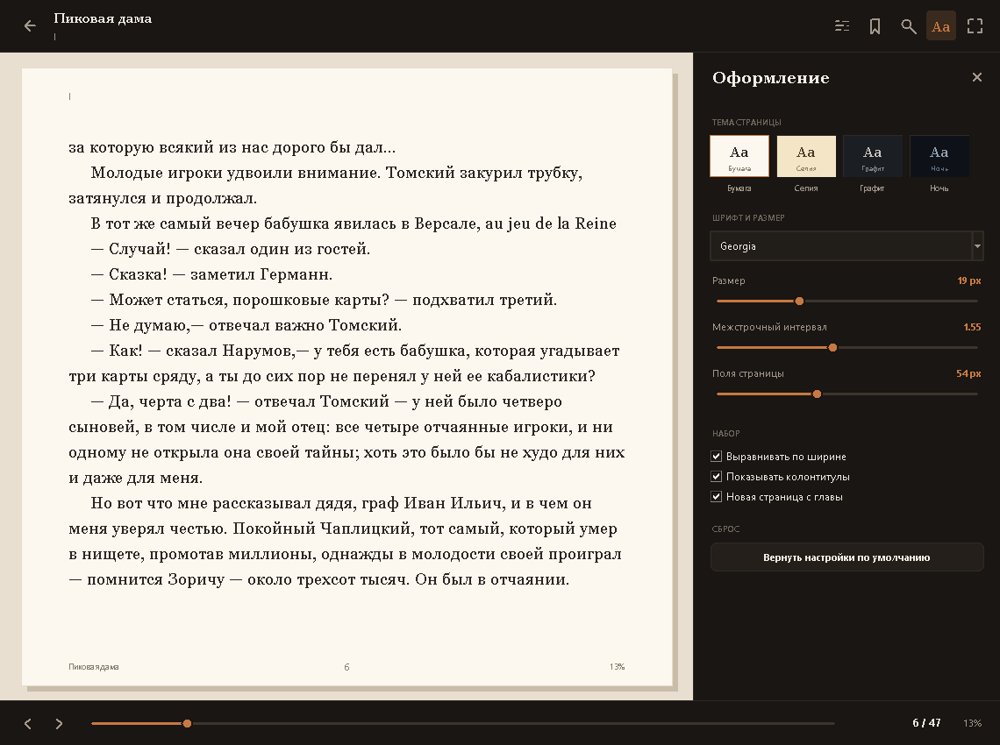

PDF:

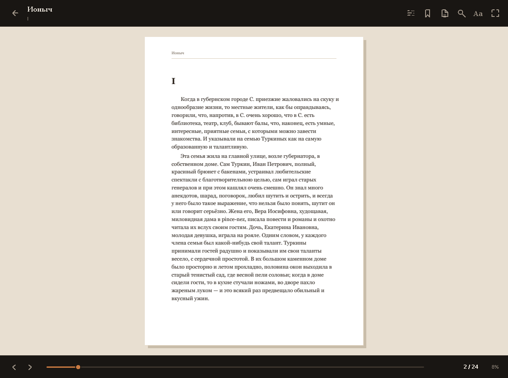

Карточка книги из каталога:

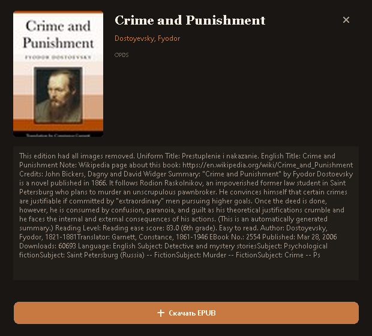

## Структура проекта

```
Chitalka/
    main.py                 точка входа и диагностические режимы
    run.bat                 запуск в один клик
    requirements.txt        зависимости
    chitalka/
        config.py           пути, настройки, геометрия окон
        db.py               SQLite: книги, прогресс, закладки, поиск
        importer.py         фоновое сканирование папок
        layout.py           постраничная вёрстка (Canvas)
        covers.py           обложки: извлечение и генерация
        genres.py           русские названия жанров FB2
        opds.py             OPDS 1/2: ленты, поиск, скачивание
        wikisource.py       Викитека: поиск и сохранение в FB2
        dictionary.py       словарь и перевод по выделению
        offline_dict.py     офлайн-словарь FreeDict (SQLite)
        backup.py           резервная копия и восстановление
        updater.py          проверка обновлений GitHub
        winutil.py          снимок окна через PrintWindow
        formats/
            fb2.py          FB2/FB2.ZIP, сноски, стихи, картинки
            epub.py         EPUB 2/3, OPF, nav/NCX, XHTML
            pdf.py          PDFium: метаданные, обложка, рендер, поиск
            txt.py          кодировки, главы, абзацы
            model.py        блоки, стили, главы
        ui/
            library.py      главное окно библиотеки
            reader.py       окно чтения и панели
            catalog.py      окно каталогов OPDS/Викитеки
            stats.py        статистика чтения
            allnotes.py     все заметки библиотеки и экспорт
            wizard.py       мастер первого запуска
            about.py        о программе и лицензии
            lookup.py       словарь и перевод
            notes.py        маркеры, комментарии, панель выделения
            widgets.py      кнопки, поиск, обложки, диалоги
            icons.py        векторные иконки на Canvas
    tools/
        make_samples.py     сборка демо-книг
        fetch_texts.py      загрузка текстов общественного достояния
        build_exe.py        сборка exe
        build_offline_dict.py  сборка FreeDict-словаря
        package.py          portable-zip и SHA-256
        sign_exe.ps1        подпись exe (нужен сертификат)
        make_icon.py        иконка приложения
        texts/              исходники демо-текстов
    legal/                  EULA, конфиденциальность, лицензии
        licenses/           42+ полных текста лицензий
    tests/                  pytest: парсеры, БД, OPDS, backup
    installer/              Inno Setup
    landing/                лендинг
    marketing/              тарифы, видео, список функций
    data/
        books/              демонстрационные книги
        covers/             кэш обложек
        dictionaries/       офлайн-словарь FreeDict (CC BY-SA 3.0)
        images/             иллюстрации из книг (создаётся при чтении)
        screenshots/        снимки для README
        library.db          библиотека (создаётся при запуске)
        settings.json       настройки (создаётся при запуске)
```

## Сборка exe

```bat
pip install pyinstaller
python tools/build_exe.py
```

Скрипт собирает `dist/Chitalka/Chitalka.exe`, кладёт рядом папку `data` с
демо-книгами и обложками. Сборка однопапочная (`_internal` + exe), запускается
двойным кликом, Python на целевой машине не нужен.

Портативный архив и контрольная сумма:

```bat
python tools/package.py
```

Установщик: `installer/Chitalka.iss` для Inno Setup. Подпись exe —
`tools/sign_exe.ps1` (нужен Code Signing сертификат). Проверка обновлений —
в окне «О программе» (GitHub Releases).

## Тесты

```bat
pip install -r requirements-dev.txt
python -m pytest -q
```

Тесты проверяют парсеры FB2/EPUB/PDF/TXT, вёрстку, заметки, кэш, OPDS,
резервное копирование и перевод без сети. CI: `.github/workflows/tests.yml`.

## Правовые документы

- [EULA](legal/EULA.md) — шаблон пользовательского соглашения.
- [Политика конфиденциальности](legal/PRIVACY.md) — что хранится локально и
  когда выполняются сетевые запросы.
- [Сторонние компоненты](legal/THIRD_PARTY_NOTICES.md) — лицензии FreeDict,
  PDFium/pypdfium2, библиотек и сервисов.
- [Аудит лицензий](legal/LICENSE_AUDIT.md) — проверка runtime-зависимостей.
- [Тексты лицензий](legal/licenses/README.md) — полные тексты компонентов.
- [Блокеры коммерческого релиза](legal/RELEASE_BLOCKERS.md) — что осталось
  сделать перед продажей.

Документы доступны в приложении: **F1 → «О программе и лицензиях»**.

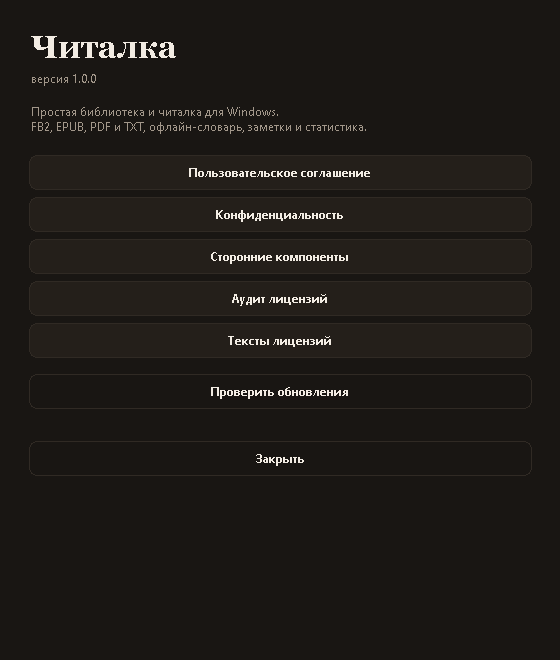

## Демонстрационные книги

В `data/books` лежат пять книг, чтобы библиотеку было видно сразу:

- Александр Пушкин. **Пиковая дама** — FB2, сноски, стихи, главы.
- Антон Чехов. **Дама с собачкой** — EPUB 3, оглавление.
- Лев Толстой. **После бала** — TXT в CP1251.
- Антон Чехов. **Ионыч** — PDF с оглавлением.
- **Стихи о природе** — FB2.ZIP: Пушкин, Лермонтов, Тютчев, стихи, сноска и иллюстрация.

Тексты взяты из Викитеки и находятся в общественном достоянии:
[Пиковая дама](https://ru.wikisource.org/wiki/Пиковая_дама_(Пушкин)),
[Дама с собачкой](https://ru.wikisource.org/wiki/Дама_с_собачкой_(Чехов)),
[После бала](https://ru.wikisource.org/wiki/После_бала_(Толстой)),
[Ионыч](https://ru.wikisource.org/wiki/Ионыч_(Чехов)).
Обложки демо-книг сгенерированы приложением.

## Известные ограничения

- Сложные таблицы и многоколоночная вёрстка EPUB упрощаются до строк текста.
- PDF не перевёрстывается: страница отображается как изображение, масштабируется
  по высоте окна.
- DRM-защищённые EPUB/PDF не открываются.
- Поиск по PDF идёт по текстовому слою; для сканов без OCR он ничего не найдёт.
- Каталоги OPDS и Викитека требуют интернет. Каталоги с авторизацией или только
  с OPDS 2 JSON могут не открыться; поддерживаются открытые OPDS 1.2 и базовый OPDS 2.
- Статистика считает активное время: если свернуть читалку или уйти в другое окно,
  время останавливается.
- Выделение текста, маркеры и заметки работают в FB2/EPUB/TXT и в PDF со
  текстовым слоем. В сканах без OCR выделять нечего; сама читалка PDF и закладки
  работают.
- PDF-маркеры рисуются поверх страницы полупрозрачной штриховкой, а не меняют
  сам PDF-файл.
- **Офлайн-словарь** работает без сети для 104 781 статьи. Перевод **фраз**
  требует настроенного DeepL/LibreTranslate или сохранённого кэша; одиночные слова
  переводятся офлайн. Онлайн-запросы отправляют выделенный текст в выбранный сервис
  (Викисловарь, DeepL, LibreTranslate или MyMemory).
- Для перевода фраз по умолчанию ничего не отправляется: выбран режим «только
  офлайн», пока пользователь явно не настроит провайдера.
- Очень большие книги (миллионы символов) верстаются дольше и занимают больше памяти.
