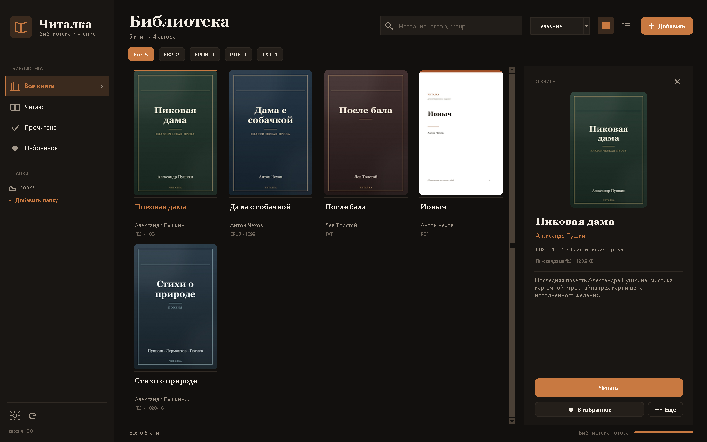

# 📖 Читалка — библиотека и чтение книг

Настольное приложение для Windows: аккуратная **домашняя библиотека** и **читалка**
с постраничной вёрсткой. Поддерживает **FB2**, **FB2.ZIP**, **EPUB**, **PDF** и **TXT**,
работает полностью офлайн.


## Возможности

### Библиотека

- Сканирование папок **рекурсивно**: добавляйте целые коллекции книг.
- Карточки с обложками, автором, годом, форматом и прогрессом чтения.
- Поиск по названию, автору, серии и жанру — мгновенный, по локальной базе SQLite.
- Фильтры по формату, коллекции **«Читаю»**, **«Прочитано»**, **«Избранное»**.
- Сортировка: недавние, по названию, автору, году, прогрессу, дате добавления.
- Два вида: **обложками** и **списком**.
- Карточка книги: аннотация, метаданные, размер файла, прогресс, кнопка
  «Читать / Продолжить / Перечитать».
- Если у книги нет обложки, рисуется типографская обложка в книжном стиле.
- Тёмная и светлая темы интерфейса (кнопка ☀/☾ внизу слева).
- Импорт в фоне: интерфейс не подвисает, виден прогресс.

### Читалка

- **Постраничная вёрстка** с переносами, выравниванием по ширине и абзацными
  отступами.
- Оглавление FB2/EPUB/PDF, переход по главам.
- Закладки с заметками, сохранение прогресса и позиции между запусками.
- Поиск по всей книге с фрагментами и переходом на нужную страницу.
- Сноски FB2: всплывающее окно с примечанием.
- Иллюстрации внутри FB2/EPUB.
- Четыре темы страницы: **Бумага**, **Сепия**, **Графит**, **Ночь**.
- Настройки: шрифт, размер, межстрочный интервал, поля, выравнивание,
  колонтитулы, новая страница с главы.
- Полноэкранный режим (F11), мышь, клавиатура, ползунок страниц.
- PDF показывается постранично «как в оригинале», с оглавлением и поиском.
- Копирование текста текущей страницы (Ctrl+C).


## Форматы

| Формат | Чтение | Метаданные | Обложка |
| --- | --- | --- | --- |
| FB2 | ✅ постранично | название, авторы, жанр, год, серия, аннотация | из книги |
| FB2.ZIP | ✅ постранично | то же | из книги |
| EPUB 2/3 | ✅ постранично | название, автор, язык, аннотация | из книги |
| PDF | ✅ страницы | название, автор | первая страница |
| TXT | ✅ постранично | название/автор из имени файла, кодировка UTF-8/CP1251/KOI8-R | генерируется |

Дополнительно: `.zip`, внутри которого лежит один `.fb2`, распознаётся как FB2.

> **Пока не поддерживаются внутри:** MOBI, AZW3, DJVU, DOCX и книги с DRM.
> Для них нужна внешняя программа или конвертация в EPUB/FB2.

## Быстрый запуск

### Вариант 1 — готовый exe (Python не нужен)

Откройте `dist/Chitalka/Chitalka.exe`. Папку `dist/Chitalka` целиком можно
скопировать на рабочий стол или флешку — книги и база лежат внутри `data`.

### Вариант 2 — один клик из исходников

```bat
run.bat
```

Скрипт найдёт Python, при первом запуске доставит `Pillow`, `PyMuPDF`, `lxml`,
запустит программу без лишней консоли и покажет понятное сообщение, если Python
не установлен.

### Вариант 3 — вручную

```bat
pip install -r requirements.txt
python main.py
```

Нужен Python 3.10+ (проверено на 3.11) и Windows 10/11. `tkinter` входит в
стандартную сборку Python для Windows.

### Проверка установки

```bat
python main.py --selftest
```

Самопроверка читает все демо-книги, проверяет вёрстку, базу, открывает
библиотеку и читалку, ищет по книге и пишет отчёт в `data/selftest.log`
с итогом `ИТОГ: OK` или списком проблем.

Дополнительно:

```bat
python main.py --repair                 :: проверить целостность базы
python main.py --shot data/shot.png     :: снимок библиотеки
python main.py --shot data/r.png --book "Пиковая дама" --page 5
```

## Как добавить книги

1. Нажмите **«Добавить»** справа сверху.
2. Выберите **«Добавить папку…»** — приложение просканирует её и все подпапки.
3. Или **«Добавить файлы…»** — можно выбрать отдельные книги.
4. Список папок хранится в настройках; при следующем запуске они проверяются
   автоматически (новые файлы добавляются, изменённые — обновляются).

Файлы **не копируются** и **не изменяются**. В базе хранится путь, метаданные и
прогресс; обложки кэшируются в `data/covers`, иллюстрации — в `data/images`.
Удаление из библиотеки убирает только запись, файл на диске остаётся.

## Горячие клавиши

| Клавиша | Действие |
| --- | --- |
| `←` / `→`, `PgUp` / `PgDn` | предыдущая / следующая страница |
| `Space` / `Shift+Space` | вперёд / назад |
| `Home` / `End` | начало / конец книги |
| `Ctrl+F` | поиск по книге |
| `Ctrl+T` | оглавление |
| `Ctrl+B` | закладки |
| `Ctrl+C` | скопировать текст страницы |
| `Alt+←`, `Backspace` | назад по ссылкам/истории |
| `F11` | полноэкранный режим |
| `Esc` | закрыть панель / выйти из полноэкранного режима |

Клик по левой или правой четверти страницы тоже перелистывает.

## Скриншоты

Библиотека с карточкой книги:



Настройки чтения:


PDF:


## Структура проекта

```
Chitalka/
    main.py                 точка входа и диагностические режимы
    run.bat                 запуск в один клик
    requirements.txt        зависимости
    chitalka/
        config.py           пути, настройки, геометрия окон
        db.py               SQLite: книги, прогресс, закладки, поиск
        importer.py         фоновое сканирование папок
        layout.py           постраничная вёрстка (Canvas)
        covers.py           обложки: извлечение и генерация
        genres.py           русские названия жанров FB2
        winutil.py          снимок окна через PrintWindow
        formats/
            fb2.py          FB2/FB2.ZIP, сноски, стихи, картинки
            epub.py         EPUB 2/3, OPF, nav/NCX, XHTML
            pdf.py          PyMuPDF: метаданные, обложка, рендер, поиск
            txt.py          кодировки, главы, абзацы
            model.py        блоки, стили, главы
        ui/
            library.py      главное окно библиотеки
            reader.py       окно чтения и панели
            widgets.py      кнопки, поиск, обложки, диалоги
            icons.py        векторные иконки на Canvas
    tools/
        make_samples.py     сборка демо-книг
        fetch_texts.py      загрузка текстов общественного достояния
        build_exe.py        сборка exe
        make_icon.py        иконка приложения
        texts/              исходники демо-текстов
    data/
        books/              демонстрационные книги
        covers/             кэш обложек
        images/             иллюстрации из книг (создаётся при чтении)
        screenshots/        снимки для README
        library.db          библиотека (создаётся при запуске)
        settings.json       настройки (создаётся при запуске)
```

## Сборка exe

```bat
pip install pyinstaller
python tools/build_exe.py
```

Скрипт собирает `dist/Chitalka/Chitalka.exe`, кладёт рядом папку `data` с
демо-книгами и обложками. Сборка однопапочная (`_internal` + exe), запускается
двойным кликом, Python на целевой машине не нужен.

## Демонстрационные книги

В `data/books` лежат пять книг, чтобы библиотеку было видно сразу:

- Александр Пушкин. **Пиковая дама** — FB2, сноски, стихи, главы.
- Антон Чехов. **Дама с собачкой** — EPUB 3, оглавление.
- Лев Толстой. **После бала** — TXT в CP1251.
- Антон Чехов. **Ионыч** — PDF с оглавлением.
- **Стихи о природе** — FB2.ZIP: Пушкин, Лермонтов, Тютчев, стихи, сноска и иллюстрация.

Тексты взяты из Викитеки и находятся в общественном достоянии:
[Пиковая дама](https://ru.wikisource.org/wiki/Пиковая_дама_(Пушкин)),
[Дама с собачкой](https://ru.wikisource.org/wiki/Дама_с_собачкой_(Чехов)),
[После бала](https://ru.wikisource.org/wiki/После_бала_(Толстой)),
[Ионыч](https://ru.wikisource.org/wiki/Ионыч_(Чехов)).
Обложки демо-книг сгенерированы приложением.

## Известные ограничения

- Сложные таблицы и многоколоночная вёрстка EPUB упрощаются до строк текста.
- PDF не перевёрстывается: страница отображается как изображение, масштабируется
  по высоте окна.
- DRM-защищённые EPUB/PDF не открываются.
- Поиск по PDF идёт по текстовому слою; для сканов без OCR он ничего не найдёт.
- Очень большие книги (миллионы символов) верстаются дольше и занимают больше памяти.
